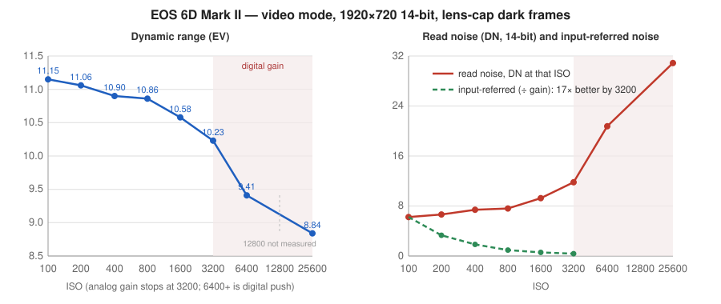
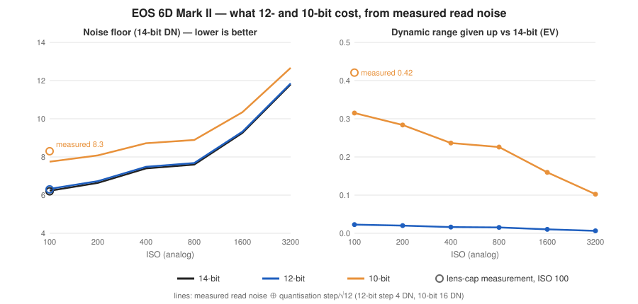
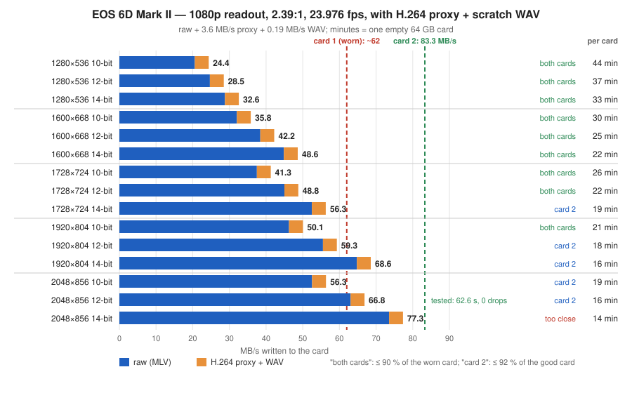

# Magic Lantern for the Canon EOS 6D Mark II — development log

**Build v87 · 20 October 2026 · firmware 1.1.1 · base `magiclantern_simplified` @ `40c0a133b`**

The 6D Mark II is a DIGIC 7 body. The official ML build for it boots and shows the menu, and not
much else. This port adds raw video at 10/12/14-bit with an in-camera H.264 proxy, the full
LiveView overlay set, scratch audio with a level meter, video dual ISO in the 1:1 readout, top-button overlay toggles
and *Format card, keep ML*. Everything below was tested on one camera over seven weeks unless it
says otherwise.

This log is in strict build order. Findings that a later build overturned are marked
**(corrected in vNN)** where they first appear. Measurements, addresses and the rules learned the
hard way are collected in the appendices.

---

## Status at v87

| | |
|---|---|
| **Working** | Raw video (MLV) 14/12/10-bit · 1080p up to 2048 wide · 1:1 crop mode up to 3072×926 · **RAW + H.264 proxy on one card** · scratch WAV with clip-named files and a level meter · video dual ISO (crop readout) · focus peaking, zebras, false colour, waveform, histogram, vectorscope, spotmeter, magic zoom (YUV and raw sources) · recorded-area frame guides · flip-screen overlays in all three positions · top buttons (AF, ISO, DRIVE/metering/AF-point, light) as overlay toggles · **Format card, keep ML** · clean HDMI · shutter angle · photo dual ISO · `mlv_play` (10/12/14-bit, slow) |
| **Not possible so far** | FPS override · 24p in the crop readout · lossless compression · 4K / custom crop windows · expo override · video dual ISO in 1080p · ML audio capture (`mlv_snd`) · H.264 bitrate control · telling DRIVE, metering and the AF-point button apart (the MPU sends identical messages) |
| **Firmware 1.2.0** | Source kept in step; last booted in QEMU at v83; not shipped |

---

## Part 1 — Bring-up (1–2 September)

### v1–v5 · 1 September — the port boots, and overlays appear for the first time

Work began on firmware 1.2.0, which ML does not support; Canon blocks downgrades. 1.2.0 turned out
to be 1.1.1 plus insertions, so stubs move by a constant per ROM region, and ML reached its banner
in QEMU. Hardware was blocked on a signing problem: the boot flag needs an `ML-SETUP.FIR` built for
1.2.0, and only the ML team can produce one. The camera was then returned to 1.1.1, where ML is
officially supported, and all further work targets `platform/6D2.111`.

**Overlays never worked on any `FEATURE_VRAM_RGBA` camera.** DIGIC 7 replaced the 8-bit indexed
bitmap with an RGBA layer fed by a compositor: ML draws into an 8-bit *shadow* buffer, and
`refresh_yuv_from_rgb()` converts it when `ml_refresh_display_needed` is set. Two faults, both
required for anything to appear:

1. **Wrong buffer.** Zebras, peaking and false colour drew through `bmp_vram_real()`, which on these
   bodies is Canon's 32-bit layer, not the shadow buffer. Added `bmp_vram_overlay()`.
2. **No composite request.** Menus and text set the refresh flag; the overlay pass never did.

The DISP struct (`*(0x7dc8)`) reports the live buffer size at `+0x94/+0x98`: **736×480 in photo
LiveView, 736×408 in movie mode**. `vram.c` had 480 hard-coded and read 72 rows past the buffer.

By v5: focus peaking, false colour, raw video (`mlv_lite`, 14-bit), photo dual ISO and the
recorded-area frame guide (which needed only `FEATURE_CROPMARKS` and one gated line).

### v6–v9 · 2 September — the frame rate was mislabelled, not wrong

- **v6** The compositor converted all 518,400 pixels per pass through a call and a bounds check.
  The LUT was padded from 80 to 256 entries and indexed directly; an alpha test used `&&` where
  `&` was meant.
- **v7** Footage was tagged **35.9 fps**. VIDF timestamps across four clips gave a constant 41,707 µs
  per frame: the camera records a steady **23.976**, and `TG_FREQ_BASE` (66.8 MHz) was wrong for
  this body. Solved against the measurement: **44.636 MHz**. Clips recorded before v7 play 1.5×
  fast until set to 23.976 in MLV App. Shutter-angle display added.
- **v8** The timer registers ML read are Canon RAM shadows that move during LiveView, and mlv_lite
  samples the rate once per take, so two clips could carry different header rates. The rate is
  now derived from the video mode (PAL integers, NTSC ÷1.001).
- **v9** A hardware assert (`raw_info.bits_per_pixel == bpp`) proved 12/10-bit was writing
  mis-packed frames: `_EngDrvOut()` is an empty stub on this body, so the sensor stayed at 14-bit.
  `CONFIG_NO_ENGIO_WRITES` pins 14-bit **(corrected in v49)**. `mlv_play` ships with `silent`,
  which exports its only unresolved symbol.

A card that "corrupted" every clip was macOS's doing: 63 `._*` AppleDouble files collided in FAT
8.3 short-name space. Clips were intact after `chkdsk /f /x`. Cards stay off macOS, or are mounted
read-only.

---

## Part 2 — Monitoring, scratch audio, mlv_lite fixes (7–17 September)

### v10–v13 · 7 September — a WAV recorder with no video

- **Scratch audio (v11).** Canon's factory eventprocs include a standalone WAV recorder:
  `FA_AudioRecStart` / `FA_AudioRecStop` (`0xe008c0a0` / `0xe008c0ac`), 48 kHz 16-bit stereo,
  **0.19 MB/s**, no video. The ML route (`mlv_snd`) needs ASIF functions this body does not expose.
- **Monitoring suite (v11).** Zebras, waveform, vectorscope, histogram, raw histogram, spotmeter,
  magic zoom and ghost image enabled: pure compute and draw. `FEATURE_ZEBRA_FAST` stays off (it
  needs `EngDrvOut` and a real `LCD_Palette`).
- **RAW false colour (v12)** reads the sensor instead of Canon's preview, so "clipped" means the
  photosites are full. WAV auto-start with mlv_lite.
- **H.264 proxy width bound.** `use_h264_proxy()` compared the raw width against a hard-coded 2080;
  this body's 1080p raw is 2128 wide, so the proxy silently never ran **(the proxy did not work
  end to end until v84)**.
- **v13** A read-only hardware probe traced the CMOS gain tables to a keyed tune-data store in
  **ROM1 at `0xb30000`**. Its conclusion — no per-ISO table in the video path, so no video dual
  ISO — was **wrong (corrected in v41)**.

### v14–v40 · 7–17 September — one fix per build

These builds are not individually dated.

| Build | Change |
|---|---|
| v14 | **Eventproc calling convention**: `call()` hands the eventproc a pointer to the vararg array. Passing `&struct` had asserted the CMOS probe and misnamed WAVs. Vectorscope chroma read without its `+0x80` bias (every neutral pixel landed on the rim) — upstream bug on all DIGIC 6+ |
| v15–v16 | `redraw()` now clears ML's layer (Canon never does on RGBA bodies), never while recording. `os.off_169` from the real 408-row height. RAW waveform. Peaking scanned every third row (dots); now every second (lines) |
| v17 | WAV renamed `<clip>.WAV`, and stopped before the buffer flush rather than after it |
| v18–v22 | INFO key clears the overlay. Three wrong guesses at a second-take failure, each a real defect |
| v23–v24 | **`REC_TRACE` found the mlv_lite buffer bug** in one shoot: teardown frees the buffers unconditionally, and reallocation waits for a state change that a raw-only take never makes. Every second take was a 1 KB file. The H.264 proxy masks it, which is likely how it survived upstream |
| v25–v26 | Reallocation edge-triggered on the teardown; take start waits out the reallocation window ("Raw detect error") |
| v27 | WAV stopped on every exit path (six `goto cleanup` sites left Canon's recorder running) |
| v28 | Peaking noise rejection: a hit must repeat on two frames (*Steady*), optionally a ±2 px Laplacian (*Wide*) |
| v29 | WAV rename waits for Canon to close the file (`FileIO.c:119` assert); no recorder call on a stale flag (`SoundDevice.c:469`) |
| v30 | Clean HDMI out |
| v31 | WAV take counter persisted: Canon's recorder *appends* to an existing `SampleN.wav` (a 25 s take carried 414 s of audio) |
| v32–v33 | Flipped screen: Canon mirrors the image layer, not ML's; ML reflects its `BM2LV_X` table instead (one lever for every overlay) |
| v34 | Peaking alignment: the vertical mapping came from another body; this one's movie image is 408 rows at 36–444, 1:1 |
| v35–v36 | Cropmarks *OFF* relabelled *Recorded area* (upstream's OFF *is* that rectangle). Framing guide inside it. Peaking's x-cache rebuilds on `tx` and mirror changes. An 8-pixel horizontal correction centred the panel in the 736-wide buffer **(wrong; corrected in v82)** |
| v37 | mlv_lite's preview heuristic (`width > 2000`) tripped on this body's ordinary 2028-wide LiveView, so ML's slow preview replaced Canon's permanently. Auto now uses Canon's |
| v38 | Cropmarks with a real OFF; empty-folder crash (`cropmark_names[-1]`) guarded |
| v39 | **Aspect honesty**: every clip before v39 was 2.67:1 whatever the menu said. The guide mapped onto 480 rows instead of the 408 image rows, and upstream clamps *height* when an aspect needs more rows than exist. *If too tall: Shrink width* added |
| v40 | Bitmap cropmarks compiled out (their submenu tripped Canon's LiveView engine, `LvJob.c:203`) |

---

## Part 3 — Dual ISO, crop mode, bit depth (17–24 September)

### v41–v46 · 17–18 September — video dual ISO in the 1:1 readout

The LiveView ISO tables exist after all, in the same sensor-config block as the photo ladder
(ROM `0xe1980000`): four 26-row tables, one per readout. Canon copies the row for the current ISO
into a working list every frame, so a patched row is live on the next frame.

- **5× zoom (true 1:1, 3264×942 raw):** dual ISO works — low-low-HIGH-HIGH line pairs, cr2hdr
  compatible.
- **3× binned 1080p:** the patched row reaches the sensor and nothing changes. A sensor behaviour,
  so `dual_iso` stays inactive there.

**Crop mode**: mlv_lite holds Canon's 5× zoom, a real 1:1 window (3164×926 active), always
**29.97 fps** whatever the movie mode. Needed `PROP_LV_DISPSIZE` write access. The RAW submenu was
patched *by index*, so inserting an entry silently capped the aspect list; lookups now use `.priv`.

### v47–v58 · 18–19 September — 12/10-bit through Canon's own path

- **v47–v49 · the first clean bit-depth switch on a DIGIC 7 body.** Not `EngDrvOut`. Canon's raw
  tap is the Mem1 path, whose update function (`0xe01470fe`) hard-codes the depth twice: bits per
  pixel (`mov.w r0,#0xe`) and a PACK32 code (`mov.w r0,#2`; 0 = 10, 1 = 12, 2 = 14). Both
  immediates are patched through the MMU patch manager and LiveView is bounced. The depth in effect
  is read back from the write DMAC's pitch, so `raw_info` cannot claim a depth the data lacks.
- **Frame rates per readout:** headers carry 23.976 / 29.97 / 59.94 for 1080p and 29.97 for crop.
- **v50–v54, v58 · 24p in crop: negative, five ways** (timer B, timing-list edits, ROM list
  patches). Canon re-asserts the frame period on the sensor side. Parked.
- **v56** The MMU patch pool moved to heap-backed pages; a second ROM page had failed.
- **SD bus (v55–v57).** The SDR104 path reads at ~100 MB/s and Canon already runs its fastest
  divider. The write limit is the card: an Extreme Plus writes 65 MB/s.

### v59–v63 · 19–24 September — stability and the black level

- **v59** Canon's timer getters assert (`ImgSeqCoopStore.c:194`) for a moment during every LiveView
  mode change; ML reads the store directly.
- **v60–v61** A depth bounce at record stop ran into Canon's teardown (`LvJob.c:203`, then
  `EvfState.c:601`). The depth is now held between clips: one bounce when it is changed, none at
  start or stop.
- **v62 · black level, wrong on every lit clip.** ML measured black from columns 16–84 because the
  border came from the full-resolution CR2 (116 px). The 1080p raw is binned 3× across, so only
  ~40 columns are optical black. Headers read 2128–3654 against a true 2047, and MLV App crushed
  everything below. Pinned at **2047 / 512 / 128** (14/12/10-bit); `fix_mlv_black.py` repairs old
  clips. The readout is now judged from the DMAC width (2128 binned, 3264 crop), not the zoom
  property, which flips before Canon rebuilds.
- **v63** Scratch WAVs had always used the internal mic: the factory recorder chooses the mic by a
  factory flag, not jack detection. Input select (Auto / Internal / External) and gain. The public
  repository was created.

---

## Part 4 — A regression, a revert, and a sounder design (24 September – 1 October)

### v64–v66 · 24–25 September — features that broke the overlay engine

- **v64** added: 12/10-bit recording fixed ("Raw detect error" — an upstream check refuses any depth
  but 14); **2048-wide 1080p** (the binned readout has 2080 active columns, not 1920); the 1.90:1
  DCI aspect; gain calibrated in dB from Canon's per-input tables (0.375 dB steps); a real
  per-channel right gain with a *Safety* mode (Canon's driver writes the left value to both
  registers); WAVs filed in `DCIM/AUDIO`; a LiveView audio meter; a button-event log in `gui.c`.
- **v65** reordered the Movie tab.
- **v66** confirmed on hardware: 12-bit records, 2048 is clean to all four edges, the black level
  is right, per-channel gain reaches the hardware. Fixed: a `%c` in a path created a folder of 23
  B's (Canon's `vsnprintf` has no `%c`); two owners of the zoom (the depth bounce and crop mode's
  hold) thrashed Canon's LiveView job manager; a three-strikes retry locked out for good. The
  button log was reverted: 2.5 KB of static data on a body with ~11 KB of headroom.

**But LiveView overlays, frame guides and INFO had stopped working, and v64, v65 and v66 shipped
that way.**

### v67 · 25 September — the overlay gate rule

The cause was the audio meter task. It drew into ML's layer and set the refresh flag twenty times a
second, gated only on `lv`. On an RGBA body that flag makes the compositor push ML's layer over
whatever Canon is showing, so the meter fought Canon's UI continuously.

**Rule: anything that draws in LiveView is gated on `liveview_display_idle()`, never on `lv`.**

v67 reverted all v64–v66 display and menu work, kept the two fixes that draw nothing (any-depth
recording; the zoom-ownership fix), and shelved the rest to return one at a time.

### v68–v71 · 25–28 September — measure, then rebuild

- **v68** added instrumentation only: what the depth switch asked of the DMAC, what it got, and why.
- **v69 · the DIGIC 6/7/8 overlay model.** On DIGIC 4/5, Canon repaints its bitmap layer and wipes
  ML's graphics; stale content heals itself. Here **Canon never clears ML's layer**, so any change
  of LiveView mode needs an explicit `redraw()`. The zoom bounce and the crop hold never called it.
  The depth switch had also never been broken: it applied one selection late, because it refused
  to run while the ML menu was open.
- **v70** `liveview_display_idle()` replaced four timers and counters. With the ML menu up, Canon
  does not rebuild the raw path at all, so the depth is applied when the menu closes.
- **v71** Two shelved items back: `DCIM/AUDIO` filing and gain in 3 dB stops.

### v72–v76 · 30 September – 1 October — the depth switch settles

- **v72 · never key a visible retry on the state it changes.** v70 retried per *(depth, zoom)*; a
  failed bounce ended on a new zoom, which triggered another bounce, and every magnify press too.
  Split into **arm** (patch the ROM immediates; invisible; follows the menu) and **apply** (one
  bounce, only when the ML menu closes or RAW video starts). Canon's own rebuilds pick up an armed
  depth for free. Alternating lines at 5× were dual ISO doing its job.
- **v73** Three bugs v72 exposed: an assert from a stale depth read; 12-bit unrecognisable from the
  pitch at 14; `set_lv_zoom()` returning on Canon's *first* broadcast. `raw_lv_zoom_to()` now waits
  for the view to arrive (property and DMAC both).
- **v74 · data loss.** A take that stopped before creating its file deleted the *previous* clip
  (stale filename, zero bytes written). Cleanup now removes only a file the take created. Canon
  ignores a zoom request that arrives while it is still settling; the way back is re-sent. Refusals
  are judged by the readout, not the zoom property.
- **v75** Shelved items back: 2048-wide 1080p with the DCI aspect, and the Movie tab with RAW video
  first and one *Scratch audio* submenu last. Crop mode re-arms on the lens AF/MF switch.
- **v76** Each readout keeps its own resolution pick. An audit removed every timer and retry without
  evidence behind it. The fast-card test suite and `cardcheck.py` (21/21 self-tests) were added.
  Only the audio meter remains shelved.

---

## Part 5 — Release shape and field rounds (2–14 October)

- **2 October** Fillable PDF of the fast-card test sheet.
- **13 October** Repository reorganised for non-developers (download, docs, tools, testing).
- **v77 · 14 October.** Peaking froze after a LiveView photo: quick review drew on ML's layer, and
  nothing cleared it on return (the v69 rule again). Flip-screen overlays got one setting per
  screen position. A d7probe frame-rate experiment writes Canon's own timer-B store and calls its
  apply function. Hot-shoe flash eventprocs proved inert outside factory mode.
- **v78 · 14 October.** With the mirror on, the recorded-area shading anchored on the *mirrored*
  mapping and blacked out position 1. Geometry now uses the unmirrored `BM2LV_Xu/Yu`.
- **14 October** The repository history was rebuilt as a clean sequence of feature commits on
  upstream `40c0a133b`, each building on its own.

---

## Part 6 — Proxy, keep-ML format, alignment (16–19 October)

Two new SanDisk Extreme PRO cards; five test rounds.

### v79 · 16 October

- **Flip screen, again.** `BM2LV_DX/DY` — *distances* — were also mirrored, so with the mirror on
  they came out negative. Recomputing raw geometry on menu close turned the shading inside out.
  Distances and anchors now use the unmirrored mapping everywhere. **Trash not opening the ML menu
  in position 1 was the same blackout.**
- **Top buttons.** AF, ISO, DRIVE and metering have no button codes on this body: a press is a
  generic `0x4b` followed by Canon's top-LCD update `0x62`, whose arg says what Canon did (AF
  `0x16`/`0x11`, ISO `0x1e`, DRIVE and metering both `9` — identical, as is the AF-point button).
  An event-spy hook confirmed no other event type carries the identity, then was removed. Overlay →
  *Top buttons (movie)*: a toggle per button. Nothing is blocked; ISO stays dial-adjustable until
  its screen closes.
- **Playback.** `raw_preview_fast_ex()` drew only 14-bit; it now reads 10/12-bit in playback
  (LiveView unchanged). A playback tone curve (12 EV, gamma 2.2) replaces one that crushed the
  bottom stops (2.3 % of pixels at 0 → 0.7 %).

### v80 · 17 October

- **`bmp_idle_copy()` on RGBA bodies** copied half a megabyte between Canon's layer and an address
  with bit 19 flipped — unrelated memory. `mlv_play` did it every tenth frame: smeared controls left
  on screen. Now a no-op on those bodies (upstream bug). Leaving playback clears ML's layer.
- Grey *fast* playback (it was green: U = V = 0 is neutral only on DIGIC ≤ 5).
- Scratch audio Mode order OFF / Auto with RAW / Manual.
- **d7probe alignment dump**: ML's mapping plus the mean luma of every LiveView buffer column.

### v81 · 19 October

- MLV headers say **24000/1001** (30000/1001, 60000/1001) instead of 23976/1000.
- A half-written `.IDX` is removed instead of left at 0 bytes. The loader never accepted those; clips
  only opened slowly.
- WAV rename waits up to 10 s after a long take; a full card is named as the reason.
- `cardcheck.py` measures fps over the whole clip; `1e6 / median` wandered 23.975–23.979.

### v82 · 19 October — the 8-pixel offset

The alignment dumps show the picture in buffer columns **0–719** and a flat padding band at 720–735,
in every screen position and after a depth switch. v36's centring (`tx = 8`) put every overlay 8 px
left of the picture, 8 px right in the mirrored position, and read the padding band at the left
edge there — a stray column of peaking dots. `tx = 0`.

### v83–v84 · 19 October — the proxy, three faults deep

Each fault hid behind the previous one; `REC_TRACE` found the last two.

1. **(v80, v82) Reallocation never ran.** A proxy take frees mlv_lite's buffers, starts Canon's
   H.264 and waits for reallocation. That needed `gui_state` idle, which a recording camera never
   reports, and the wait had no limit: *Starting...* forever. v80 bounded and logged the wait and
   dropped the GUI check; v82 makes reallocation wait for `RECORDING_H264_STARTED`, because at
   "starting" it took the memory Canon's recorder needed.
2. **(v83) `movie_start()` was empty.** The 6D2 never defined `CONFIG_MOVIE`. An MP4 seen earlier
   came from the user's own REC press.
3. **(v84) ML could not see Canon recording.** `PROP_MVR_REC_START` had been on the 6D2's
   do-not-read list since the first port. Of the handlers it wakes, only one touches hardware —
   `enable_recording()`, which wakes an AK audio-codec task this body does not have. That handler is
   skipped on the 6D2 and the property is read again. No freeze.

**Result:** 2048×856 12-bit, 62.6 s, 1,502 frames, no drops, beside Canon's MP4 at ~3.6 MB/s;
stopping the take stops both. Clips pair by number (`IMG_9482.MLV` ↔ `MVI_9482.MP4`).

Also v83: after a depth bounce the overlay mapping and raw geometry are marked stale; screenshots on
RGBA bodies take their colours from the compositor's table; mlv_lite logs why a take ran out of
buffer.

### v85 · 19 October — Format card, keep ML

Each format module keeps its globals in a small block with the dialog handle at `+4`.
`StopMnCardFormatBeginApp` (`0xe0718044`) deletes `[0x229cc+4]`; `StopMnCardFormatexcuteApp`
(`0xe074f25a`) deletes `[0x27730+4]`. So `DIALOG_MnCardFormatBegin = 0x229d0` and
`DIALOG_MnCardFormatExecute = 0x27734`. On DIGIC 7 the watcher keys on the dialog handle (not
`MENU_MODE`), messages use `NotifyBox`, the restore waits until Canon has finished formatting, and
the camera asks for a power cycle. The boot flag is rewritten by the installer's own function. Also
fixed for every body: the backup used to retry forever with the UI locked when memory was short.
Confirmed on the camera.

### v86 · 19 October — release

The port's shooting setup became the default settings (scratch audio Auto with RAW, H.264 proxy on,
sync beep off, raw false colour / waveform / zebras, AF = peaking, DRIVE = false colour). ML stores
only changed values, so existing cards keep their owner's choices. `REC_TRACE` off.

## Part 7 — The buttons' last layer, and wrap-up (20 October)

### The MPU log

DRIVE, metering and the AF-point button had always reached ML as the same event pair. Lua cannot
help: its key events come after ML's own handler, one layer above what the probe already logged.
The layer below is the MPU, the chip that reads the buttons. Canon's SIO3 interrupt keeps the last
80 received MPU messages in a ring of pointers (`0x80d84`, index at `0x7c00`; each message at
pointer + 4, first byte its length). d7probe's state logger now copies them every 10 ms, read-only,
onto one timeline with the GUI events.

Result, on 843 messages: every top-button press is the generic `06 05 06 26 01 00` ("a button was
pressed", the source of GUI event `0x4b`), then the MPU's own decision as `0a 08 <id> …`, which is
GUI event `0x62` — its `obj` words are those bytes, little-endian. In movie mode DRIVE, metering
and AF-point all send `0a 08 20 00 00 04` (show "not available") and `0a 08 20 00 00 00` (clear it)
~200–330 ms later, byte for byte. In photo mode they open different dialogs, and AF-point's warning
carries flag `08` instead of `04`. **The button's identity never leaves the MPU.** The light button
is the generic message alone, which no other button produces.

### v87 · 20 October

- **Light button** as a fourth top-button toggle: after each generic event a small task waits
  200 ms and acts only if nothing else arrived (other buttons' follow-ups come within ~15 ms in
  movie mode, ~100 ms in photo mode). The handler now runs first in ML's button chain, so a button
  ML consumes cannot pass for light. The settings moved from Overlay to **Prefs**.
- **Audio level meter**, the last item shelved in the v67 revert, back under the overlay rule:
  draws only while `liveview_display_idle()`, at 10 Hz, clears its own rectangle once when it has
  to go away, *While recording* only.
- **One developer module.** d7probe became *6D2 developer tools*: state / button / MPU logger,
  dumps, the two register experiments marked as such, and the status + sensor-block dump that had
  lived in the core's `run_test()` (now upstream's again). `REC_TRACE` became the module's
  **Recording trace** switch, read by mlv_lite once per take, and the trace now logs the scratch
  WAV's start and stop and the first frame — for the short-WAV question below. `adtglog2` is
  hidden in the Modules menu.

---

## Appendix A — Measurements

### ISO response in video mode

Read noise from lens-cap dark frames, 1920×720 14-bit (black 2047, white 16200). Dark mean within
0.1 DN of the header black on every clip; two ISO 100 takes agreed to 0.5 %.

| ISO | analog | read noise | dynamic range | input-referred |
|---|---|---|---|---|
| 100 | 100 | 6.23 DN | **11.15 EV** | 6.23 |
| 200 | 200 | 6.64 | 11.06 | 3.32 |
| 400 | 400 | 7.40 | 10.90 | 1.85 |
| 800 | 800 | 7.60 | 10.86 | 0.95 |
| 1600 | 1600 | 9.26 | 10.58 | 0.58 |
| 3200 | 3200 | 11.80 | 10.23 | 0.37 |
| 6400 | 3200 + 1 EV digital | 20.76 | 9.41 | — |
| 25600 | 3200 + 3 EV digital | 30.87 | 8.84 | — |



Analog gain stops at 3200 in video mode. The sensor is strongly ISO-variant: up to 3200, each stop
costs ~0.14 EV of range while input-referred noise improves 17×. Set the ISO you need rather than
lifting in post. Third stops are a full stop plus a digital push baked into the raw.

### Bit depth

Raw is linear, so lower depths lose levels from the bottom stops first. Cost = quantisation noise
(step/√12: 1.15 DN at 12-bit, 4.6 DN at 10-bit, in 14-bit units) added to the read noise above.

| ISO | 14-bit | 12-bit | 10-bit | 10-bit range given up |
|---|---|---|---|---|
| 100 | 6.23 DN | 6.33 model · **6.3 measured** | 7.75 model · **8.3 measured** | 0.32 EV model · **0.42 measured** |
| 800 | 7.60 | 7.68 | 8.89 | 0.23 EV |
| 3200 | 11.80 | 11.85 | 12.67 | 0.10 EV |



12-bit is lossless in practice. 10-bit costs a third to half a stop of shadow range at base ISO —
more than the model, which treats quantisation as uniform noise — and is hard to see from ISO 800.
8-bit is not reachable (Canon's packer has codes for 10/12/14 only) and its 64 DN step would be ten
times the read noise.

### Cards and data rates

ML's *Quick R/W benchmark*, run in a photo mode (with RAW video on, mlv_lite holds the benchmark's
memory):

| Card | Write | Read |
|---|---|---|
| SanDisk Extreme Plus 64 GB | 65 MB/s | — |
| SanDisk Extreme PRO 64 GB, new | 82.9 MB/s | 89.6 MB/s |
| the same card after one full fill, camera-formatted | 62–65 MB/s | 96.3 MB/s |
| SanDisk Extreme PRO 64 GB, second card | 83.3 MB/s | 95.7 MB/s |

The bus is not the limit; the card's write speed is, and a camera format does not restore a card
slowed by a full fill. On the good card, 81.6 MB/s ran 66 s and 88.0 MB/s stopped in ~12 s. A format
runs indefinitely when it stays under the card's *slowest* writing, not its benchmark average.

**Ladder** — 1080p readout, 2.39:1, 23.976 fps, raw + H.264 proxy (3.6 MB/s) + WAV (0.19 MB/s).
Narrower widths are centre crops of the readout, not downscales.

| Size | 10-bit | 12-bit | 14-bit | per 64 GB card (10 / 12 / 14) |
|---|---|---|---|---|
| 1280×536 | 24.4 MB/s | 28.5 | 32.6 | 44 / 37 / 33 min |
| 1600×668 | 35.8 | 42.2 | 48.6 | 30 / 25 / 22 min |
| 1728×724 | 41.3 | 48.8 | 56.3 | 26 / 22 / 19 min |
| 1920×804 | 50.1 | 59.3 | 68.6 | 21 / 18 / 16 min |
| 2048×856 | 56.3 | **66.8 (tested)** | 77.3 | 19 / 16 / 14 min |



---

## Appendix B — DIGIC 7 rules learned the hard way

1. **Canon never clears ML's layer.** Every transition that leaves ML content on screen needs an
   explicit `redraw()` / `clrscr()` — but never a full clear while recording (Canon ERRs).
2. **Anything that draws in LiveView is gated on `liveview_display_idle()`**, not `lv`.
3. **Chroma is biased by 0x80.** Use `UYVY_PACK` / `UYVY_GET_U/V`; hand-packed 0 is green.
4. **Never key a visible retry on the state it changes.**
5. **`call()` passes a pointer to the vararg array**, not your struct.
6. **Canon's `vsnprintf` has no `%c`.**
7. **No static buffers in the core** — `user_mem` has ~11 KB of headroom. Diagnostics go in a module.
8. **Canon drops a zoom request made while it is still settling**, and `set_lv_zoom()` returns on
   the first broadcast, before the view arrives.
9. **Platform switches can be silently absent.** `CONFIG_MOVIE` and a denied property kept the proxy
   dead for seven weeks; check what a feature compiles to before debugging what it does.
10. **The platform build reuses stale modules** — `make clean` in `modules/` after header changes.

---

## Appendix C — Addresses (1.1.1)

| | |
|---|---|
| `call` | `0xe04e7432` |
| DISP struct pointer | `0x7dc8` (size at `+0x94` / `+0x98`) |
| Mem1 raw-path update (depth immediates) | `0xe01470fe` |
| LiveView ISO tables | sensor-config block, ROM `0xe1980000` + `0x0ef4` / `0x11cc` / `0x14a4` / `0x177c` |
| Photo CMOS ISO table | `0xe1980b30` |
| ROM1 tune-data store | ROM1 offset `0xb30000` |
| `FA_AudioRecStart` / `Stop` | `0xe008c0a0` / `0xe008c0ac` |
| WAV path builder | `0xe064fc6e` (`B:/Sample%d.wav`) |
| Audio gain registers | `0xd8000550` (L) / `0xd8000554` (R); meter `0xd8000190` |
| Timer-B store / apply | `0x1c928 + 0x1c` / `0xe03029bc` |
| Format dialogs | Begin `0x229d0`, Execute `0x27734` |
| MPU receive ring / index | `0x80d84` (80 pointers, message at +4) / `0x7c00` |
| Card device for the boot flag | `sd_device` `0x20054` |

---

## Appendix D — Known issues

- Peaking needs one ML menu open/close after power-on and after a bit-depth change.
- The H.264 proxy is proven on a 62 s take; long and back-to-back proxy takes are untested.
- `mlv_play` needs `silent` loaded, and is slow. Review the proxy MP4 in Canon's player (disable
  `mlv_play`, which otherwise takes over PLAY).
- Scratch WAVs on 10-bit and crop takes ran up to 2.2 s *shorter* than the clip (start late or
  paused); 12/14-bit 1080p takes run +0.5 to +0.8 s. Not yet explained; v87's recording trace logs
  the WAV start/stop and first frame to find out which.
- Clips recorded before v62 carry a wrong black level; before v7, a wrong frame rate.
- One mic feeds both WAV channels; per-channel source is not possible in Canon's driver.

---

## Appendix E — Building

```sh
cd modules && make clean && rm -rf build   # first: the platform build reuses stale .mo files
cd ../platform/6D2.111 && make clean && make zip_contents   # card files in build/zip
```

`make disk_image` cannot work under WSL2 (no kernel for libguestfs); build a card image with
`mtools` instead. `make clean` is mandatory after changing `RESTARTSTART`. To log the record path
to `ML/LOGS/RECDBG.LOG`, load the developer module (`d7probe`) and switch on Debug → 6D2 developer
tools → Recording trace. Release zips: `6D2/tools/dev/package.py`.

Built on `magiclantern_simplified`. The DIGIC 6/7/8 compositor groundwork (`FEATURE_VRAM_RGBA`) is
the work of srsa, kitor and others named in those files.
