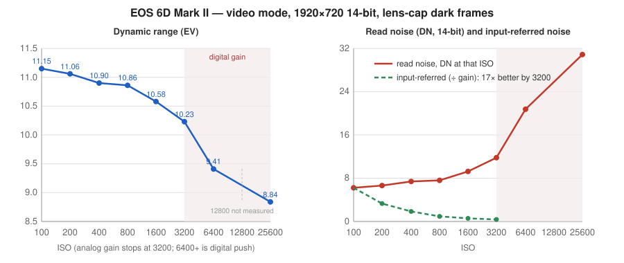
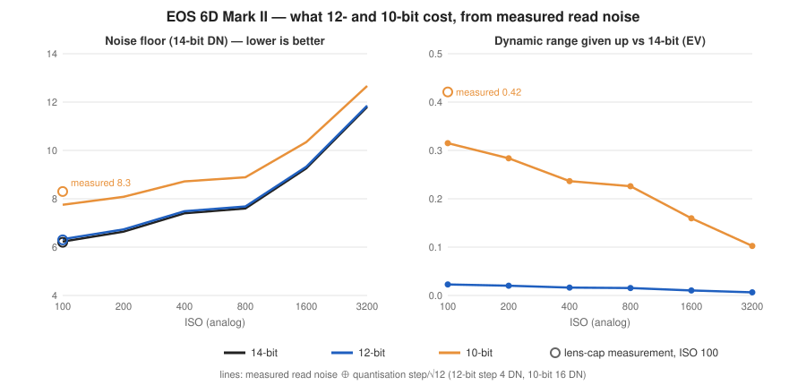
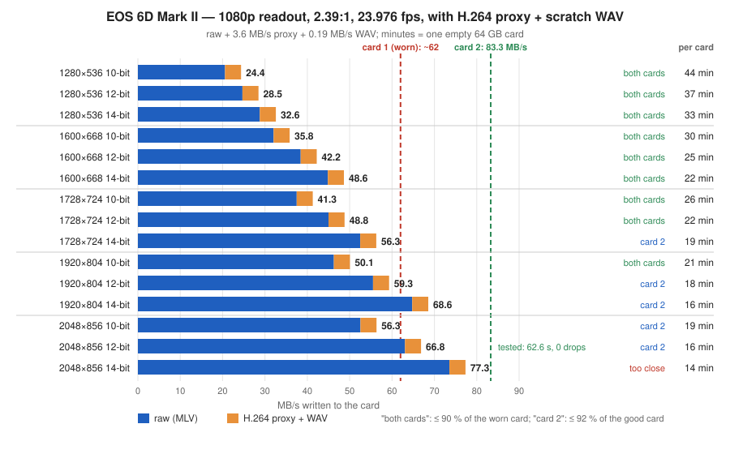

# Magic Lantern for the Canon EOS 6D Mark II — development log

**Build v136 · 6 November 2026 · firmware 1.1.1 · base `magiclantern_simplified` `dev` @ `142472e95` (merged in v132; the port began at `40c0a133b`)**

The 6D Mark II is a DIGIC 7 body. The official ML build for it boots and shows the menu, and not
much else. This port adds raw video at 10/12/14-bit, lossless raw video at 14 and 12-bit, an in-camera H.264
proxy, a gyro log for stabilising in post, the full LiveView overlay set, scratch audio with a level meter, video dual ISO in the 1:1 readout, top-button overlay toggles
and *Format card, keep ML*. Everything below was tested on one camera over ten weeks unless it
says otherwise.

This log is in strict build order. Findings that a later build overturned are marked
**(corrected in vNN)** where they first appear. Measurements, addresses and the rules learned the
hard way are collected in the appendices.

---

## Status at v136

| | |
|---|---|
| **Working** | Raw video (MLV) 14/12/10-bit · **14 and 12-bit lossless at 23.976 and 59.94p, and in crop mode** · gyro log inside the clip (experimental) · clip slate · card time left and temperature warning in the recording status · 1080p up to 2048 wide · 1:1 crop mode up to 3072×926 · **RAW + H.264 proxy on one card** · scratch WAV with clip-named files and a level meter · video dual ISO (crop readout) · focus peaking, zebras, false colour, waveform, histogram, vectorscope, spotmeter, magic zoom (YUV and raw sources) · recorded-area frame guides · flip-screen overlays in all three positions · top buttons (AF, ISO, DRIVE/metering/AF-point) as overlay toggles · shutter angle lock · **Format card, keep ML** · clean HDMI · shutter angle · photo dual ISO · `mlv_play` (10/12/14-bit, slow) |
| **Not possible so far** | FPS override · 24p in the crop readout · 4K / custom crop windows · expo override · video dual ISO in 1080p · ML audio capture (`mlv_snd`) · H.264 bitrate control · telling DRIVE, metering and the AF-point button apart (the MPU sends identical messages) |
| **Known limit** | 59.94p above 1920×960 fails: the encoder needs more than a frame's time |
| **Firmware 1.2.0** | Source kept in step; last booted in QEMU at v83; not shipped |

---

## Part 1 — Bring-up (1–2 September)

### v1–v5 · 1 September — the port boots, and overlays appear for the first time

Work began on firmware 1.2.0, which ML does not support; Canon blocks downgrades. 1.2.0 turned out
to be 1.1.1 plus insertions, so stubs move by a constant per ROM region, and ML reached its banner
in QEMU. Hardware was blocked on a signing problem: the boot flag needs an `ML-SETUP.FIR` built for
1.2.0, and only the ML team can produce one. The camera was then returned to 1.1.1, where ML is
officially supported, and all further work targets `platform/6D2.111`.

**Overlays never worked on any `FEATURE_VRAM_RGBA` camera.** DIGIC 7 replaced the 8-bit indexed
bitmap with an RGBA layer fed by a compositor: ML draws into an 8-bit *shadow* buffer, and
`refresh_yuv_from_rgb()` converts it when `ml_refresh_display_needed` is set. Two faults, both
required for anything to appear:

1. **Wrong buffer.** Zebras, peaking and false colour drew through `bmp_vram_real()`, which on these
   bodies is Canon's 32-bit layer, not the shadow buffer. Added `bmp_vram_overlay()`.
2. **No composite request.** Menus and text set the refresh flag; the overlay pass never did.

The DISP struct (`*(0x7dc8)`) reports the live buffer size at `+0x94/+0x98`: **736×480 in photo
LiveView, 736×408 in movie mode**. `vram.c` had 480 hard-coded and read 72 rows past the buffer.

By v5: focus peaking, false colour, raw video (`mlv_lite`, 14-bit), photo dual ISO and the
recorded-area frame guide (which needed only `FEATURE_CROPMARKS` and one gated line).

### v6–v9 · 2 September — the frame rate was mislabelled, not wrong

- **v6** The compositor converted all 518,400 pixels per pass through a call and a bounds check.
  The LUT was padded from 80 to 256 entries and indexed directly; an alpha test used `&&` where
  `&` was meant.
- **v7** Footage was tagged **35.9 fps**. VIDF timestamps across four clips gave a constant 41,707 µs
  per frame: the camera records a steady **23.976**, and `TG_FREQ_BASE` (66.8 MHz) was wrong for
  this body. Solved against the measurement: **44.636 MHz**. Clips recorded before v7 play 1.5×
  fast until set to 23.976 in MLV App. Shutter-angle display added.
- **v8** The timer registers ML read are Canon RAM shadows that move during LiveView, and mlv_lite
  samples the rate once per take, so two clips could carry different header rates. The rate is
  now derived from the video mode (PAL integers, NTSC ÷1.001).
- **v9** A hardware assert (`raw_info.bits_per_pixel == bpp`) proved 12/10-bit was writing
  mis-packed frames: `_EngDrvOut()` is an empty stub on this body, so the sensor stayed at 14-bit.
  `CONFIG_NO_ENGIO_WRITES` pins 14-bit **(corrected in v49)**. `mlv_play` ships with `silent`,
  which exports its only unresolved symbol.

A card that "corrupted" every clip was macOS's doing: 63 `._*` AppleDouble files collided in FAT
8.3 short-name space. Clips were intact after `chkdsk /f /x`. Cards stay off macOS, or are mounted
read-only.

---

## Part 2 — Monitoring, scratch audio, mlv_lite fixes (7–17 September)

### v10–v13 · 7 September — a WAV recorder with no video

- **Scratch audio (v11).** Canon's factory eventprocs include a standalone WAV recorder:
  `FA_AudioRecStart` / `FA_AudioRecStop` (`0xe008c0a0` / `0xe008c0ac`), 48 kHz 16-bit stereo,
  **0.19 MB/s**, no video. The ML route (`mlv_snd`) needs ASIF functions this body does not expose.
- **Monitoring suite (v11).** Zebras, waveform, vectorscope, histogram, raw histogram, spotmeter,
  magic zoom and ghost image enabled: pure compute and draw. `FEATURE_ZEBRA_FAST` stays off (it
  needs `EngDrvOut` and a real `LCD_Palette`).
- **RAW false colour (v12)** reads the sensor instead of Canon's preview, so "clipped" means the
  photosites are full. WAV auto-start with mlv_lite.
- **H.264 proxy width bound.** `use_h264_proxy()` compared the raw width against a hard-coded 2080;
  this body's 1080p raw is 2128 wide, so the proxy silently never ran **(the proxy did not work
  end to end until v84)**.
- **v13** A read-only hardware probe traced the CMOS gain tables to a keyed tune-data store in
  **ROM1 at `0xb30000`**. Its conclusion — no per-ISO table in the video path, so no video dual
  ISO — was **wrong (corrected in v41)**.

### v14–v40 · 7–17 September — one fix per build

These builds are not individually dated.

| Build | Change |
|---|---|
| v14 | **Eventproc calling convention**: `call()` hands the eventproc a pointer to the vararg array. Passing `&struct` had asserted the CMOS probe and misnamed WAVs. Vectorscope chroma read without its `+0x80` bias (every neutral pixel landed on the rim) — upstream bug on all DIGIC 6+ |
| v15–v16 | `redraw()` now clears ML's layer (Canon never does on RGBA bodies), never while recording. `os.off_169` from the real 408-row height. RAW waveform. Peaking scanned every third row (dots); now every second (lines) |
| v17 | WAV renamed `<clip>.WAV`, and stopped before the buffer flush rather than after it |
| v18–v22 | INFO key clears the overlay. Three wrong guesses at a second-take failure, each a real defect |
| v23–v24 | **`REC_TRACE` found the mlv_lite buffer bug** in one shoot: teardown frees the buffers unconditionally, and reallocation waits for a state change that a raw-only take never makes. Every second take was a 1 KB file. The H.264 proxy masks it, which is likely how it survived upstream |
| v25–v26 | Reallocation edge-triggered on the teardown; take start waits out the reallocation window ("Raw detect error") |
| v27 | WAV stopped on every exit path (six `goto cleanup` sites left Canon's recorder running) |
| v28 | Peaking noise rejection: a hit must repeat on two frames (*Steady*), optionally a ±2 px Laplacian (*Wide*) |
| v29 | WAV rename waits for Canon to close the file (`FileIO.c:119` assert); no recorder call on a stale flag (`SoundDevice.c:469`) |
| v30 | Clean HDMI out |
| v31 | WAV take counter persisted: Canon's recorder *appends* to an existing `SampleN.wav` (a 25 s take carried 414 s of audio) |
| v32–v33 | Flipped screen: Canon mirrors the image layer, not ML's; ML reflects its `BM2LV_X` table instead (one lever for every overlay) |
| v34 | Peaking alignment: the vertical mapping came from another body; this one's movie image is 408 rows at 36–444, 1:1 |
| v35–v36 | Cropmarks *OFF* relabelled *Recorded area* (upstream's OFF *is* that rectangle). Framing guide inside it. Peaking's x-cache rebuilds on `tx` and mirror changes. An 8-pixel horizontal correction centred the panel in the 736-wide buffer **(wrong; corrected in v82)** |
| v37 | mlv_lite's preview heuristic (`width > 2000`) tripped on this body's ordinary 2028-wide LiveView, so ML's slow preview replaced Canon's permanently. Auto now uses Canon's |
| v38 | Cropmarks with a real OFF; empty-folder crash (`cropmark_names[-1]`) guarded |
| v39 | **Aspect honesty**: every clip before v39 was 2.67:1 whatever the menu said. The guide mapped onto 480 rows instead of the 408 image rows, and upstream clamps *height* when an aspect needs more rows than exist. *If too tall: Shrink width* added |
| v40 | Bitmap cropmarks compiled out (their submenu tripped Canon's LiveView engine, `LvJob.c:203`) |

---

## Part 3 — Dual ISO, crop mode, bit depth (17–24 September)

### v41–v46 · 17–18 September — video dual ISO in the 1:1 readout

The LiveView ISO tables exist after all, in the same sensor-config block as the photo ladder
(ROM `0xe1980000`): four 26-row tables, one per readout. Canon copies the row for the current ISO
into a working list every frame, so a patched row is live on the next frame.

- **5× zoom (true 1:1, 3264×942 raw):** dual ISO works — low-low-HIGH-HIGH line pairs, cr2hdr
  compatible.
- **3× binned 1080p:** the patched row reaches the sensor and nothing changes. A sensor behaviour,
  so `dual_iso` stays inactive there.

**Crop mode**: mlv_lite holds Canon's 5× zoom, a real 1:1 window (3164×926 active, corrected to 3164×896 in v130), always
**29.97 fps** whatever the movie mode. Needed `PROP_LV_DISPSIZE` write access. The RAW submenu was
patched *by index*, so inserting an entry silently capped the aspect list; lookups now use `.priv`.

### v47–v58 · 18–19 September — 12/10-bit through Canon's own path

- **v47–v49 · the first clean bit-depth switch on a DIGIC 7 body.** Not `EngDrvOut`. Canon's raw
  tap is the Mem1 path, whose update function (`0xe01470fe`) hard-codes the depth twice: bits per
  pixel (`mov.w r0,#0xe`) and a PACK32 code (`mov.w r0,#2`; 0 = 10, 1 = 12, 2 = 14). Both
  immediates are patched through the MMU patch manager and LiveView is bounced. The depth in effect
  is read back from the write DMAC's pitch, so `raw_info` cannot claim a depth the data lacks.
- **Frame rates per readout:** headers carry 23.976 / 29.97 / 59.94 for 1080p and 29.97 for crop.
- **v50–v54, v58 · 24p in crop: negative, five ways** (timer B, timing-list edits, ROM list
  patches). Canon re-asserts the frame period on the sensor side. Parked.
- **v56** The MMU patch pool moved to heap-backed pages; a second ROM page had failed.
- **SD bus (v55–v57).** The SDR104 path reads at ~100 MB/s and Canon already runs its fastest
  divider. The write limit is the card: an Extreme Plus writes 65 MB/s.

### v59–v63 · 19–24 September — stability and the black level

- **v59** Canon's timer getters assert (`ImgSeqCoopStore.c:194`) for a moment during every LiveView
  mode change; ML reads the store directly.
- **v60–v61** A depth bounce at record stop ran into Canon's teardown (`LvJob.c:203`, then
  `EvfState.c:601`). The depth is now held between clips: one bounce when it is changed, none at
  start or stop.
- **v62 · black level, wrong on every lit clip.** ML measured black from columns 16–84 because the
  border came from the full-resolution CR2 (116 px). The 1080p raw is binned 3× across, so only
  ~40 columns are optical black. Headers read 2128–3654 against a true 2047, and MLV App crushed
  everything below. Pinned at **2047 / 512 / 128** (14/12/10-bit); `fix_mlv_black.py` repairs old
  clips. The readout is now judged from the DMAC width (2128 binned, 3264 crop), not the zoom
  property, which flips before Canon rebuilds.
- **v63** Scratch WAVs had always used the internal mic: the factory recorder chooses the mic by a
  factory flag, not jack detection. Input select (Auto / Internal / External) and gain. The public
  repository was created.

---

## Part 4 — A regression, a revert, and a sounder design (24 September – 1 October)

### v64–v66 · 24–25 September — features that broke the overlay engine

- **v64** added: 12/10-bit recording fixed ("Raw detect error" — an upstream check refuses any depth
  but 14); **2048-wide 1080p** (the binned readout has 2080 active columns, not 1920); the 1.90:1
  DCI aspect; gain calibrated in dB from Canon's per-input tables (0.375 dB steps); a real
  per-channel right gain with a *Safety* mode (Canon's driver writes the left value to both
  registers); WAVs filed in `DCIM/AUDIO`; a LiveView audio meter; a button-event log in `gui.c`.
- **v65** reordered the Movie tab.
- **v66** confirmed on hardware: 12-bit records, 2048 is clean to all four edges, the black level
  is right, per-channel gain reaches the hardware. Fixed: a `%c` in a path created a folder of 23
  B's (Canon's `vsnprintf` has no `%c`); two owners of the zoom (the depth bounce and crop mode's
  hold) thrashed Canon's LiveView job manager; a three-strikes retry locked out for good. The
  button log was reverted: 2.5 KB of static data on a body with ~11 KB of headroom.

**But LiveView overlays, frame guides and INFO had stopped working, and v64, v65 and v66 shipped
that way.**

### v67 · 25 September — the overlay gate rule

The cause was the audio meter task. It drew into ML's layer and set the refresh flag twenty times a
second, gated only on `lv`. On an RGBA body that flag makes the compositor push ML's layer over
whatever Canon is showing, so the meter fought Canon's UI continuously.

**Rule: anything that draws in LiveView is gated on `liveview_display_idle()`, never on `lv`.**

v67 reverted all v64–v66 display and menu work, kept the two fixes that draw nothing (any-depth
recording; the zoom-ownership fix), and shelved the rest to return one at a time.

### v68–v71 · 25–28 September — measure, then rebuild

- **v68** added instrumentation only: what the depth switch asked of the DMAC, what it got, and why.
- **v69 · the DIGIC 6/7/8 overlay model.** On DIGIC 4/5, Canon repaints its bitmap layer and wipes
  ML's graphics; stale content heals itself. Here **Canon never clears ML's layer**, so any change
  of LiveView mode needs an explicit `redraw()`. The zoom bounce and the crop hold never called it.
  The depth switch had also never been broken: it applied one selection late, because it refused
  to run while the ML menu was open.
- **v70** `liveview_display_idle()` replaced four timers and counters. With the ML menu up, Canon
  does not rebuild the raw path at all, so the depth is applied when the menu closes.
- **v71** Two shelved items back: `DCIM/AUDIO` filing and gain in 3 dB stops.

### v72–v76 · 30 September – 1 October — the depth switch settles

- **v72 · never key a visible retry on the state it changes.** v70 retried per *(depth, zoom)*; a
  failed bounce ended on a new zoom, which triggered another bounce, and every magnify press too.
  Split into **arm** (patch the ROM immediates; invisible; follows the menu) and **apply** (one
  bounce, only when the ML menu closes or RAW video starts). Canon's own rebuilds pick up an armed
  depth for free. Alternating lines at 5× were dual ISO doing its job.
- **v73** Three bugs v72 exposed: an assert from a stale depth read; 12-bit unrecognisable from the
  pitch at 14; `set_lv_zoom()` returning on Canon's *first* broadcast. `raw_lv_zoom_to()` now waits
  for the view to arrive (property and DMAC both).
- **v74 · data loss.** A take that stopped before creating its file deleted the *previous* clip
  (stale filename, zero bytes written). Cleanup now removes only a file the take created. Canon
  ignores a zoom request that arrives while it is still settling; the way back is re-sent. Refusals
  are judged by the readout, not the zoom property.
- **v75** Shelved items back: 2048-wide 1080p with the DCI aspect, and the Movie tab with RAW video
  first and one *Scratch audio* submenu last. Crop mode re-arms on the lens AF/MF switch.
- **v76** Each readout keeps its own resolution pick. An audit removed every timer and retry without
  evidence behind it. The fast-card test suite and `cardcheck.py` (21/21 self-tests) were added.
  Only the audio meter remains shelved.

---

## Part 5 — Release shape and field rounds (2–14 October)

- **2 October** Fillable PDF of the fast-card test sheet.
- **13 October** Repository reorganised for non-developers (download, docs, tools, testing).
- **v77 · 14 October.** Peaking froze after a LiveView photo: quick review drew on ML's layer, and
  nothing cleared it on return (the v69 rule again). Flip-screen overlays got one setting per
  screen position. A d7probe frame-rate experiment writes Canon's own timer-B store and calls its
  apply function. Hot-shoe flash eventprocs proved inert outside factory mode.
- **v78 · 14 October.** With the mirror on, the recorded-area shading anchored on the *mirrored*
  mapping and blacked out position 1. Geometry now uses the unmirrored `BM2LV_Xu/Yu`.
- **14 October** The repository history was rebuilt as a clean sequence of feature commits on
  upstream `40c0a133b`, each building on its own.

---

## Part 6 — Proxy, keep-ML format, alignment (16–19 October)

Two new SanDisk Extreme PRO cards; five test rounds.

### v79 · 16 October

- **Flip screen, again.** `BM2LV_DX/DY` — *distances* — were also mirrored, so with the mirror on
  they came out negative. Recomputing raw geometry on menu close turned the shading inside out.
  Distances and anchors now use the unmirrored mapping everywhere. **Trash not opening the ML menu
  in position 1 was the same blackout.**
- **Top buttons.** AF, ISO, DRIVE and metering have no button codes on this body: a press is a
  generic `0x4b` followed by Canon's top-LCD update `0x62`, whose arg says what Canon did (AF
  `0x16`/`0x11`, ISO `0x1e`, DRIVE and metering both `9` — identical, as is the AF-point button).
  An event-spy hook confirmed no other event type carries the identity, then was removed. Overlay →
  *Top buttons (movie)*: a toggle per button. Nothing is blocked; ISO stays dial-adjustable until
  its screen closes.
- **Playback.** `raw_preview_fast_ex()` drew only 14-bit; it now reads 10/12-bit in playback
  (LiveView unchanged). A playback tone curve (12 EV, gamma 2.2) replaces one that crushed the
  bottom stops (2.3 % of pixels at 0 → 0.7 %).

### v80 · 17 October

- **`bmp_idle_copy()` on RGBA bodies** copied half a megabyte between Canon's layer and an address
  with bit 19 flipped — unrelated memory. `mlv_play` did it every tenth frame: smeared controls left
  on screen. Now a no-op on those bodies (upstream bug). Leaving playback clears ML's layer.
- Grey *fast* playback (it was green: U = V = 0 is neutral only on DIGIC ≤ 5).
- Scratch audio Mode order OFF / Auto with RAW / Manual.
- **d7probe alignment dump**: ML's mapping plus the mean luma of every LiveView buffer column.

### v81 · 19 October

- MLV headers say **24000/1001** (30000/1001, 60000/1001) instead of 23976/1000.
- A half-written `.IDX` is removed instead of left at 0 bytes. The loader never accepted those; clips
  only opened slowly.
- WAV rename waits up to 10 s after a long take; a full card is named as the reason.
- `cardcheck.py` measures fps over the whole clip; `1e6 / median` wandered 23.975–23.979.

### v82 · 19 October — the 8-pixel offset

The alignment dumps show the picture in buffer columns **0–719** and a flat padding band at 720–735,
in every screen position and after a depth switch. v36's centring (`tx = 8`) put every overlay 8 px
left of the picture, 8 px right in the mirrored position, and read the padding band at the left
edge there — a stray column of peaking dots. `tx = 0`.

### v83–v84 · 19 October — the proxy, three faults deep

Each fault hid behind the previous one; `REC_TRACE` found the last two.

1. **(v80, v82) Reallocation never ran.** A proxy take frees mlv_lite's buffers, starts Canon's
   H.264 and waits for reallocation. That needed `gui_state` idle, which a recording camera never
   reports, and the wait had no limit: *Starting...* forever. v80 bounded and logged the wait and
   dropped the GUI check; v82 makes reallocation wait for `RECORDING_H264_STARTED`, because at
   "starting" it took the memory Canon's recorder needed.
2. **(v83) `movie_start()` was empty.** The 6D2 never defined `CONFIG_MOVIE`. An MP4 seen earlier
   came from the user's own REC press.
3. **(v84) ML could not see Canon recording.** `PROP_MVR_REC_START` had been on the 6D2's
   do-not-read list since the first port. Of the handlers it wakes, only one touches hardware —
   `enable_recording()`, which wakes an AK audio-codec task this body does not have. That handler is
   skipped on the 6D2 and the property is read again. No freeze.

**Result:** 2048×856 12-bit, 62.6 s, 1,502 frames, no drops, beside Canon's MP4 at ~3.6 MB/s;
stopping the take stops both. Clips pair by number (`IMG_9482.MLV` ↔ `MVI_9482.MP4`).

Also v83: after a depth bounce the overlay mapping and raw geometry are marked stale; screenshots on
RGBA bodies take their colours from the compositor's table; mlv_lite logs why a take ran out of
buffer.

### v85 · 19 October — Format card, keep ML

Each format module keeps its globals in a small block with the dialog handle at `+4`.
`StopMnCardFormatBeginApp` (`0xe0718044`) deletes `[0x229cc+4]`; `StopMnCardFormatexcuteApp`
(`0xe074f25a`) deletes `[0x27730+4]`. So `DIALOG_MnCardFormatBegin = 0x229d0` and
`DIALOG_MnCardFormatExecute = 0x27734`. On DIGIC 7 the watcher keys on the dialog handle (not
`MENU_MODE`), messages use `NotifyBox`, the restore waits until Canon has finished formatting, and
the camera asks for a power cycle. The boot flag is rewritten by the installer's own function. Also
fixed for every body: the backup used to retry forever with the UI locked when memory was short.
Confirmed on the camera.

### v86 · 19 October — release

The port's shooting setup became the default settings (scratch audio Auto with RAW, H.264 proxy on,
sync beep off, raw false colour / waveform / zebras, AF = peaking, DRIVE = false colour). ML stores
only changed values, so existing cards keep their owner's choices. `REC_TRACE` off.

## Part 7 — The buttons' last layer, and wrap-up (20 October)

### The MPU log

DRIVE, metering and the AF-point button had always reached ML as the same event pair. Lua cannot
help: its key events come after ML's own handler, one layer above what the probe already logged.
The layer below is the MPU, the chip that reads the buttons. Canon's SIO3 interrupt keeps the last
80 received MPU messages in a ring of pointers (`0x80d84`, index at `0x7c00`; each message at
pointer + 4, first byte its length). d7probe's state logger now copies them every 10 ms, read-only,
onto one timeline with the GUI events.

Result, on 843 messages: every top-button press is the generic `06 05 06 26 01 00` ("a button was
pressed", the source of GUI event `0x4b`), then the MPU's own decision as `0a 08 <id> …`, which is
GUI event `0x62` — its `obj` words are those bytes, little-endian. In movie mode DRIVE, metering
and AF-point all send `0a 08 20 00 00 04` (show "not available") and `0a 08 20 00 00 00` (clear it)
~200–330 ms later, byte for byte. In photo mode they open different dialogs, and AF-point's warning
carries flag `08` instead of `04`. **The button's identity never leaves the MPU.** The light button
is the generic message alone, which no other button produces.

### v87 · 20 October

- **Light button** as a fourth top-button toggle: after each generic event a small task waits
  200 ms and acts only if nothing else arrived (other buttons' follow-ups come within ~15 ms in
  movie mode, ~100 ms in photo mode). The handler now runs first in ML's button chain, so a button
  ML consumes cannot pass for light. The settings moved from Overlay to **Prefs**.
- **Audio level meter**, the last item shelved in the v67 revert, back under the overlay rule:
  draws only while `liveview_display_idle()`, at 10 Hz, clears its own rectangle once when it has
  to go away, *While recording* only.
- **One developer module.** d7probe became *6D2 developer tools*: state / button / MPU logger,
  dumps, the two register experiments marked as such, and the status + sensor-block dump that had
  lived in the core's `run_test()` (now upstream's again). `REC_TRACE` became the module's
  **Recording trace** switch, read by mlv_lite once per take, and the trace now logs the scratch
  WAV's start and stop and the first frame — for the short-WAV question below. `adtglog2` is
  hidden in the Modules menu.

### Field round on v86, and what it added to v87

Seven clips on card 2, every one intact with no dropped frames:

| Clip | Mode | Depth | Length | WAV vs clip | MP4 vs clip |
|---|---|---|---|---|---|
| IMG_9488 / 9489 | 1080p 2048×856, proxy | 12 | 78 s / 36 s | +1.5 s | +1.9 / +1.8 s |
| **IMG_9490** | 1080p 2048×856, proxy, ISO 6400 | 12 | **749.5 s** (stopped by hand) | +1.4 s | +1.6 s |
| IMG_9491 | 1080p 2048×856, proxy | 10 | 31 s | +1.2 s | +1.6 s |
| M20-1409 / 1410 | crop 2048×856 / 1920×804 | 10 | 3 s / 31 s | +0.5 / +0.4 s | — |
| M20-1411 | crop 1920×804, dual ISO | 14 | 19 s | +0.4 s | — |

- **The H.264 proxy holds a 12.5-minute take**: 47 GB of raw plus a complete 2.9 GB MP4.
- **No short WAVs** this time, at 10-bit or in crop mode — every WAV runs past the end of its clip.
- **Dual ISO in crop mode works as set**: M20-1411 alternates line pairs by 0.97 EV with Canon ISO
  1600 and Recovery 800 (absolute), and carries a DISO block. The two 10-bit crop clips were shot
  before the module was enabled (`dual_iso.en` is dated after them).
- `cardcheck.py` flagged two "dark right edges" that were scene gradients; the test now looks for a
  step at the outer columns.
- **Temperature.** The MPU log shows the 6D2 never sends `0x80030014`, the property ML's
  temperature readout uses, but sends the board temperature `0x80030035` (MPU `03 38`) every ~30 s.
  v87 reads that: Debug → Internal Temp and the LiveView top bar, assuming raw − 128 = °C as on the
  5D2 / 50D / 100D (25–28 °C indoors; to be checked against a cold camera). Canon's own
  `PROP_TEMP_STATUS` (`0x8004000F`) drives its warning icon and the shutdown.
- **Dual ISO menu text** says how it works in video on this body: Crop mode only.

### v88 · 20 October — v87 on the camera, and a blind code review

**v87 field report.** The rear dial around SET toggled the light button's overlay: like the light
button, it sends the generic "button pressed" event and nothing else, so the light-button toggle
is gone (three toggles remain, still under Prefs). The level meter drew over a "WAV rec (int mic)"
message that stayed for the whole take: on this body `redraw()` does not clear ML's layer during a
take (a full clear mid-take killed takes), so every NotifyBox shown during a take used to stay up
until it ended. NotifyBox now erases its own rectangle while recording, and with the meter on the
message is skipped (the meter shows the mic). The temperature item shifted the other top-bar items,
so it now appears only from 45 °C. Spotmeter is off by default. The format screen showed a clean
LiveView until a dial was turned: NotifyBox's `redraw()` repainted LiveViewApp's dialog over
Canon's format dialog; `redraw()` now repaints the open format dialog instead.

**Dual ISO at 10 and 12-bit** works in crop mode (M20-1449, M20-1450). At Canon ISO 100 with
Recovery 800 the line pairs differ by 3.3× (1.7 EV) on unclipped pixels, not the nominal 8×; base
1600 against 800 gave the full 1 EV. The per-line gain switch covers only part of Canon's ISO
gain on this body, so the dynamic range gained is smaller than the menu's estimate. The 1080p
clips were correctly single-ISO and tagged inactive.

**Code review.** A blind review (no project context; upstream and the other ports as reference)
found 2 high, 7 medium and 11 low issues. The worst two were in shared code: mlv_lite called the
6D2-only scratch-WAV functions as plain externs, so every other camera's build silently dropped the
module, and bitmap cropmarks were removed for every camera. v88 fixes the first and four 6D2 ones:
the next take now waits until the last WAV is filed (a quick REC press could file audio under the
wrong clip), *Record WAV now* runs only in Manual (in Auto it could leave Canon's recorder running
with nothing to stop it), the recording trace checks for NULL, and the top buttons check Canon's
event pointer. The rest is listed in the roadmap.

### v89 · 20 October — shutter angle lock, live meter

The format screen fix was confirmed on the camera.

- **Shutter angle lock** (Expo): keeps motion blur constant across frame-rate changes, chiefly
  1080p at 23.976 against crop mode at 29.97. ML cannot touch the frame rate on this body, but it
  can ask Canon for a shutter speed the way the dial does: `PROP_SHUTTER` joins the write
  whitelist (ML already reads it for the shutter display). The lock picks the 1/3-stop speed whose
  angle, from Canon's nominal value, is closest — 180° gives 1/50 at 23.976 (172.6°) and 1/60 at
  29.97 (179.8°) — acts only outside takes with the menu closed, waits for the frame rate to read
  the same twice, and stops asking if Canon refuses.
- **Level meter**: a *Live L/R* mode (top bar strictly left, bottom strictly right, the loudest
  reading of the last 100 ms, nothing held), and the meter is one solid black box — the text's
  transparent clear had cut a window through the frame guide. A clap take's WAV showed the two
  channels genuinely differ (right about 6 dB under left, correlation 0.16), so the bars should
  too.

### v90 · 21 October — what the meter register is

On the camera the shutter angle lock worked, and so did the meter's black box. *Live L/R* did not:
drawn raw, with no ML ballistics at all, it looked exactly like the normal meter — an average level
on top and a held peak on the bottom. So the two halves of `0xd8000190` are the audio hardware's
level and peak, not left and right; the WAV's separate L and R channels never reach it. The option
is withdrawn and the meter says what it shows (`lvl … pk …`). The temperature scale was checked: a
camera left off in a 21 °C (70 °F) room read 22–23 °C at power-on, so raw − 128 = °C holds.

## Part 8 — Dual-system sound (26 October)

### v91 · 26 October

- **Bit depth at power-on.** The saved depth is meant to apply itself once when RAW video and
  movie LiveView start, but the request was cleared before looking at the result. Right after
  power-on the raw tap is not on yet, `raw_lv_apply_bpp()` returns 0 ("not possible now, nothing
  done"), and the one attempt was spent on that — the depth went live only at the next ML menu
  close. A 0 result now keeps the request for the next poll.
- **Scratch WAV timing in every clip**, for a sound recordist with Tentacle Sync. The WAV starts
  0.4–1.6 s ahead of the first frame, differently every take. `wav_scratch_start()` now timestamps
  the moment Canon's audio input goes live (SoundDevice `+0x44`, busy-polled, at most 200 ms), and
  mlv_lite writes it into the clip as an INFO block `scratch_wav_start_us=<n>` relative to the
  clip's time zero — the base of every frame's timestamp.
- **`scratch_sync.py`** (offload, standard library only): cuts each scratch WAV to start on frame 1
  and run the clip's length; decodes LTC (biphase mark, any channel, 23.976 / 24 / 25 / 29.97 DF /
  30) and stamps the WAV with the first frame's timecode as a Broadcast WAV time reference plus
  iXML; optionally remuxes exported movies with the synced scratch and `-timecode` through ffmpeg.
  The camera is not genlocked to the Tentacle, so frame 1 falls between LTC frames; the start
  timecode is the nearest one and the time reference keeps the exact sample. Self-test: synthetic
  LTC at 23.976 NDF and 29.97 DF across a minute boundary, 12/12. One constant — Canon's latency
  between the input going live and the WAV's first sample — is left for a clap-take calibration.

---

## Part 9 — Saved settings and the top buttons (28–29 October)

The first v91 field round: hand claps put the scratch audio within −12 to +10 ms of the picture with
latency 0, so that constant stays 0 for now.

- **v92** — a 14-bit take after a power cycle. Upstream's `raw_rec_init` set `output_format = 0` on
  every non-DIGIC-5 body, after the config load, so a saved 12 or 10-bit was lost at each boot. Now
  only a hidden lossless value falls back to 14-bit. Confirmed on the camera. The same reset affects
  every DIGIC 4/6/7/8 body.
- **v93** — the depth went live only after a menu close. The apply at power-on fired while Canon still
  ignores zoom requests and used up its one try; it now waits 2 s after LiveView and raw come up, and
  retries up to three times.
- **v94** — top buttons missed presses. Canon's update arrives up to 90 ms after the press, past the
  60 ms window, and unrelated updates used up the press. The window is now 250 ms, and only an update
  that matches a button uses it. The AF button works only at standby.

---

## Part 10 — Lossless raw video (29 October – 2 November)

Canon's movie path has no lossless encoder that ML can reach, but its CR2 path does. The
[findings](findings.md) have the full recipe, with addresses.

- **v95–v96** — probes of the CR2 encoder path: the configure request, JpCore setup, DMA calls.
- **v97–v101** — ML drives the encoder on a grabbed LiveView frame: without the photo step, with
  buffers from SRM and then the shoot pool at exact sizes, and with ML's Huffman tables shaped the way
  Canon wants them. Trial and error on the DEGEEN block: a zero clip zeroes the frame, and the photo's
  block shifts every pixel by one.
- **v102** — **bit-exact**, with an identity DEGEEN block.
- **v103–v106** — the same encode beside a running LiveView. Each encode turned the preview green, and
  restoring every register it changed crashed the camera (`LvJob.c:203`).
- **v107 on (1 November)** — a 6D2 backend in `modules/silent/lossless.c` behind the existing
  lossless API, so mlv_lite's DIGIC 5 pipeline runs on top of it unchanged. It records 14 and 12-bit LJ92
  that MLV Drive decodes.
- **To v111 (2 November)** — speed and the preview:
  - Polling with `msleep(1)` made a 9.5 ms encode cost 29 ms, and no 59.94p take lasted past 69 frames.
    An event-driven wait brought it to 9.3–11 ms.
  - The green turned out to be the encoder's share-memory routing. **The encoder does not need it:**
    opened with an element count of 0, it leaves LiveView alone and stays bit-exact.
  - A strict decoder passed all 5,520 frames of nine test clips at 14 and 12-bit. Noise matches
    uncompressed footage of the same scene (ratio 0.996 and 1.002).
- **v112–v118** — lossless frames written one by one stopped takes that uncompressed could hold.
  Batching writes to about 20 MB gives 67 MB/s for 31 s at 2048×1152. Crop-mode lossless recorded for
  the first time: 1640×922 at 29.97, 931 frames, encode 9.3 ms, writes 69 MB/s. The recording status
  also gained the card time left.
- **v119** — clip info (a slate in each MLV), and a temperature warning in the recording status.

---

## Part 11 — The gyro (4–5 November)

Canon's specifications list no gyro, but its electronic IS driver keeps one in plain RAM. The
[findings](findings.md) have the addresses and every measurement.

- **Before v122** — d7probe's read-only Gyro test: pitch, yaw and roll at 4 kHz, and they keep working
  during a lossless take.
- **v122** — the log: 1 kHz samples inside the clip, in `GYRI` and `GYRO` blocks, about 24 KB/s.
  `gyro_export.py` writes Gyroflow logs from them. The first attempts never recorded: it was never
  turned on, then it reset the camera at the first frame.
- **v123** — `SetHPTimerNextTick` calls the overrun callback from inside the call, so a timer that is its
  own overrun callback nests on the interrupt stack. Fixed, with a timer-only test mode. Timer only ran
  572 frames clean, but with the log on, takes hung at about 150 frames.
- **v124** — padding to 512 bytes was a wrong guess at that hang. This build did cut a second problem:
  a boot's first 59.94p take had reset the camera 9 of 9 times (`LvJob.c:203`, in Evf). With the encoder's
  buffer allocated before the take and its poll timer no longer nesting, 6 of 6 boots have passed on
  v124 and v125. Which change did it is still open.
- **v125** — the hang was a loop: the writer kept going until the ring was empty while the timer kept
  filling it, so frames stopped (`M04-1409`: 23 frames, 11,007 GYRO blocks). It now writes what was there
  when called. **Passed:** 59.94p, 4,146 frames with none dropped, 69,748 samples with none lost.

**Measured on v125 (5 November):**

- **Readout:** 10.59 µs per row in binned 1080p at 23.976 and 59.94p, half the timer B tick, from mains
  flicker on a plain wall. That makes 7.63 ms for 720 rows, 8.52 for 804, 12.2 for 1152. An earlier 15 ms
  was wrong by a factor of two, and `gyro_export.py` now uses the measured figure.
- **Scale:** pitch 83–89 LSB per deg/s, yaw a looser 62–86, roll unresolved. The takes were dark.
- **Canon's digital IS:** no measurable effect on the gyro words or the raw picture.
- **Write speed:** about 74 MB/s on an empty card, falling 0.16 MB/s per 1% of the card used.
- **Limit:** 59.94p above 1920×960 fails. Encodes reach 18.4 ms of a 16.68 ms frame.

Still to do: three-axis spins for the scale, one bright take for roll, and a first Gyroflow trial.

---

## Part 12 — A menu pass (6 November)

### v126 · 6 November

Nothing about recording changed except where the slate is kept. Not yet run on the camera; it builds and
boots in QEMU.

- **Clip info could never be set.** Its Camera, Reel, Scene, Shot and Take were children of a child: Q inside a
  submenu closes it, so they were unreachable and every slate read camera A, reel 1, scene 1, take 1. It is now on
  the main Movie menu and moved from mlv_lite into the core, so it works with RAW off.
- **Slates for every take.** A RAW take keeps its slate in the MLV. Canon's MP4 has no room for one, so an
  MP4-only take adds a line to `SLATE.CSV` beside the clips, with Resolve's column names. Take counts up either way.
- **Movie tab:** RAW video, Clip info, Shutter angle lock (from Expo), Top Button C-FN (from Prefs,
  renamed), then the rest, with MOV/MP4 time limit last.
- **RAW video:** Crop mode below Data format, Pre-record and Rec trigger above Playback, Gyro log marked
  experimental.
- **Sync beep** moved to Scratch audio: it lands on that track, and that is what it is for.
- **Temperature warning** moved to Prefs.
- **Flip-screen overlays** removed from the menu: Canon mirrors in position 1 only, as confirmed at v32
  and v79, so ML now just does that. A setting saved as off no longer applies.

### v127 · 6 November

**If too tall** had the same fault as Clip info: nested under Aspect ratio, where Q closes the submenu, so it could
never be changed. Its default, Shrink width, is the right one, so it is now **If aspect too tall** in RAW video's
Advanced section.

### v128 · 6 November

The menu layout is confirmed on the camera. Clip info's slate and SLATE.CSV are not yet tested there.

- **Movie tab:** RAW video, Scratch audio, Shutter angle lock, Clip info, Top Button C-FN, MOV/MP4 time limit.
- **RAW video:** H.264 proxy directly under Crop mode, then Gyro log. Preview joins the Advanced section.
- **Advanced entries that would not hide.** The menu always shows an advanced entry whose value differs from its
  default. If aspect too tall, the proxy and the sync beep are stored with a default of -1, meaning "not set", and
  are then given the body's real value, so they always counted as changed. The module now records that real value
  as the default.

### v129 · 6 November

New defaults: Data format is **12-bit lossless**, because 14-bit lossless at 59.94p needs more than the card sustains,
and every **Top Button C-FN** entry is OFF. Settings files store only values that differ from the default, so a
camera left on the old defaults (14-bit lossless, AF as focus peaking, DRIVE as false colour) takes the new ones.

### v130 · 6 November

**The black bar at the top of crop clips.** The code took the picture to start at row 16 in both readouts. Measured,
it starts at **row 44 of 942 in the 1:1 window** (every crop clip, whatever its size) and **row 28 of 1208 in
1080p** (a full grabbed frame). Crop clips carried 26 to 28 black rows; 1080p frames were tall enough to show it only
above about 1160 rows. Usable height is now 896 in crop mode (rows 44 to 939, the last rows seen with picture) and
1180 in 1080p. Peaking and the frame guides stay on the reference they were aligned on. Clips recorded earlier keep
their bar.

### v131 · 6 November

- **Frame guides and "ML/CROPMKS dir missing".** Format card, keep ML keeps `FONTS`, `MODULES` and `SETTINGS`, not
  `CROPMKS`. The search for cropmark files then gave up before marking cropmarks ready, so guides never drew. This
  build has no bitmap cropmarks, so it no longer looks for them. Guides stay off in crop mode and in ML's framing preview, by design.
- **False colour left on screen when turned off during a take.** Redraws stay away from a running recording, so
  nothing cleared it. It now clears itself.
- **Field round on v130.** 2048×856 at 59.94p recorded 2,563 frames. Dual ISO in crop mode at 3072×614 recorded
  1.7 EV line pairs with every frame intact. Thirteen crash logs from five crashes, all `LvJob.c:203` then
  `EvfState.c:660/584`, each 10 to 35 s after a crop-mode take ended, so none lost a take.

**On the camera, v131:**

- False colour clears when turned off mid-take: confirmed.
- Changing many settings gave no crash and no new crash log. The cause of the five crashes was not
  found and nothing in this build targets it, so they are open, not fixed.
- Frame guides were still missing, with `crop.mode = 0` and Preview on Framing both saved, either of which hides them.
  A guide with both set correctly has not been seen yet.
- Dual ISO, five more takes: 2136×894 and 3072×614, bright rows over dark 3.18 to 3.32 (1.7 EV) on every frame, none missing.
  `M06-1305` and `M06-1358` hold steps of about a third of a stop, from the exposure being changed during those takes. The
  others are steady.
- Clips from this round have no black edge rows or columns, at 2136×894, 3072×768, 3072×614 and 2048×856.

### v132 · 6 November

Upstream `dev` merged, 12 commits, to `142472e95`. One conflict, `modules/Makefile`: upstream renamed `sd_uhs` to `sd_clock`.
Most of it is other bodies. What reaches this camera:

- **`PROP_LV_ACTION` may now be written on the 6D2** (upstream's fix for two takes in a row, issue 307). This port had already
  fixed that hang inside mlv_lite. The two have not run together on the camera.
- Modules are no longer shut down on a panic (`tasks.c`), and the clock functions gained `void` prototypes.

It builds and boots in QEMU. **Not yet run on the camera.**

### v133 · 6 November

**One second-take fix, not two.** `PROP_LV_ACTION` is out of the 6D2's write list again. This port's fix is at the cause (the
buffer reallocation) and has recorded many takes in a row. Upstream's entry is not a neutral addition here: `mlv_lite` calls
`PauseLiveView()` at the end of a take without the proxy, and until now that write was refused, so LiveView kept running.
Allowing it would stop LiveView at the end of every such take, which this body has never done. 200D and 7D2 keep upstream's entry.

**Why footage looked fine on the waveform and dark in post.** The footage really is dark: the median of `M06-1435` and `-1438` (ISO 100, 1/62, f/4.9) is 5.7 stops
under clipping, and MLV Drive passes the levels through unchanged. The tools were not reading raw. `can_use_raw_overlays()` is true only at 14-bit, so at 12-bit
the waveform, histogram and false colour set to RAW silently used the preview picture, which has been through a tone curve. How far that read from the
raw levels has not been measured.

### v134 · 6 November

**Raw exposure tools at 12 and 10-bit.** Waveform, histogram, false colour, zebras and spotmeter now read raw at any depth while the camera is idle. The pixel readers return every
depth on the 14-bit scale `raw_info` already uses, so the overlays did not change. During a take below 14-bit they still fall back to the preview, as before, to keep the recording's time.
Checked off the camera: the readers give the same values at 12-bit as at 14-bit on a real grabbed frame. On the camera: RAW and Preview now differ, RAW looks the same at 14 and
12-bit lossless, and the overlays are not sluggish.

**The dark footage, measured again.** With most of the raw histogram at its middle to 65%, `M06-1529` to `-1531` (ISO 100, f/4.9, 1/48 and 1/62) have a green median 5.2 to 7.0 stops under clipping, which a
plain Rec.709 display shows at 3 to 12%. The tools were right: the raw histogram and waveform are logarithmic, so their middle is 6 stops under clipping, where middle grey belongs at about 3 to 3.5.
`-1530` and `-1531` had room for 3 more stops, with about 1% of green or less clipping.

### v135 · 6 November

- **Middle grey marker.** A yellow line on the raw histogram and waveform, 3.25 stops under clipping.
  Exposure tests on the camera found it accurate, and `M06-1605`, chosen by eye, has its median 3.6 stops under clipping.
- **Recorded-area bars.** v135 also changed the bars' colour on a wrong guess.

### v136 · 6 November

- **The missing bars were a setting.** Git shows the drawing code unchanged since the first port. The Framing preview resets the guide to the whole image, which leaves only a thin outline. Real-time on the camera
  brought the bars back, so v135's colour change is undone.
- **RAW preview** moves to the Overlay tab, as **RAW preview**, and defaults to Real-time on the 6D2.
- **Speculars.** Every clip checked saturates at the top of the range at every ISO from 100 to 1600, so the white level is right. Green clips first: in `M06-1605`, where green has clipped, red is at
  72% of its range and blue at 48%. Under 1% of pixels barely registers on Resolve's histogram, so raw false colour on the camera is the better warning.
- **Published files brought up to date:** the download (it was still v90), README, roadmap, user guide and gyro test. A new field test replaces the v79 fast-card test and the v77 retest.

---

## Appendix A — Measurements

### ISO response in video mode

Read noise from lens-cap dark frames, 1920×720 14-bit (black 2047, white 16200). Dark mean within
0.1 DN of the header black on every clip; two ISO 100 takes agreed to 0.5 %.

| ISO | analog | read noise | dynamic range | input-referred |
|---|---|---|---|---|
| 100 | 100 | 6.23 DN | **11.15 EV** | 6.23 |
| 200 | 200 | 6.64 | 11.06 | 3.32 |
| 400 | 400 | 7.40 | 10.90 | 1.85 |
| 800 | 800 | 7.60 | 10.86 | 0.95 |
| 1600 | 1600 | 9.26 | 10.58 | 0.58 |
| 3200 | 3200 | 11.80 | 10.23 | 0.37 |
| 6400 | 3200 + 1 EV digital | 20.76 | 9.41 | — |
| 25600 | 3200 + 3 EV digital | 30.87 | 8.84 | — |



Analog gain stops at 3200 in video mode. The sensor is strongly ISO-variant: up to 3200, each stop
costs ~0.14 EV of range while input-referred noise improves 17×. Set the ISO you need rather than
lifting in post. Third stops are a full stop plus a digital push baked into the raw.

### Bit depth

Raw is linear, so lower depths lose levels from the bottom stops first. Cost = quantisation noise
(step/√12: 1.15 DN at 12-bit, 4.6 DN at 10-bit, in 14-bit units) added to the read noise above.

| ISO | 14-bit | 12-bit | 10-bit | 10-bit range given up |
|---|---|---|---|---|
| 100 | 6.23 DN | 6.33 model · **6.3 measured** | 7.75 model · **8.3 measured** | 0.32 EV model · **0.42 measured** |
| 800 | 7.60 | 7.68 | 8.89 | 0.23 EV |
| 3200 | 11.80 | 11.85 | 12.67 | 0.10 EV |



12-bit is lossless in practice. 10-bit costs a third to half a stop of shadow range at base ISO —
more than the model, which treats quantisation as uniform noise — and is hard to see from ISO 800.
8-bit is not reachable (Canon's packer has codes for 10/12/14 only) and its 64 DN step would be ten
times the read noise.

### Cards and data rates

ML's *Quick R/W benchmark*, run in a photo mode (with RAW video on, mlv_lite holds the benchmark's
memory):

| Card | Write | Read |
|---|---|---|
| SanDisk Extreme Plus 64 GB | 65 MB/s | — |
| SanDisk Extreme PRO 64 GB, new | 82.9 MB/s | 89.6 MB/s |
| the same card after one full fill, camera-formatted | 62–65 MB/s | 96.3 MB/s |
| SanDisk Extreme PRO 64 GB, second card | 83.3 MB/s | 95.7 MB/s |

The bus is not the limit; the card's write speed is, and a camera format does not restore a card
slowed by a full fill. On the good card, 81.6 MB/s ran 66 s and 88.0 MB/s stopped in ~12 s. A format
runs indefinitely when it stays under the card's *slowest* writing, not its benchmark average.

**Ladder** — 1080p readout, 2.39:1, 23.976 fps, raw + H.264 proxy (3.6 MB/s) + WAV (0.19 MB/s).
Narrower widths are centre crops of the readout, not downscales.

| Size | 10-bit | 12-bit | 14-bit | per 64 GB card (10 / 12 / 14) |
|---|---|---|---|---|
| 1280×536 | 24.4 MB/s | 28.5 | 32.6 | 44 / 37 / 33 min |
| 1600×668 | 35.8 | 42.2 | 48.6 | 30 / 25 / 22 min |
| 1728×724 | 41.3 | 48.8 | 56.3 | 26 / 22 / 19 min |
| 1920×804 | 50.1 | 59.3 | 68.6 | 21 / 18 / 16 min |
| 2048×856 | 56.3 | **66.8 (tested)** | 77.3 | 19 / 16 / 14 min |



---

## Appendix B — DIGIC 7 rules learned the hard way

- **Q inside a submenu closes it.** Children of a child are unreachable unless something opens them.
1. **Canon never clears ML's layer.** Every transition that leaves ML content on screen needs an
   explicit `redraw()` / `clrscr()` — but never a full clear while recording (Canon ERRs).
2. **Anything that draws in LiveView is gated on `liveview_display_idle()`**, not `lv`.
3. **Chroma is biased by 0x80.** Use `UYVY_PACK` / `UYVY_GET_U/V`; hand-packed 0 is green.
4. **Never key a visible retry on the state it changes.**
5. **`call()` passes a pointer to the vararg array**, not your struct.
6. **Canon's `vsnprintf` has no `%c`.**
7. **No static buffers in the core** — `user_mem` has ~11 KB of headroom. Diagnostics go in a module.
8. **Canon drops a zoom request made while it is still settling**, and `set_lv_zoom()` returns on
   the first broadcast, before the view arrives.
9. **Platform switches can be silently absent.** `CONFIG_MOVIE` and a denied property kept the proxy
   dead for seven weeks; check what a feature compiles to before debugging what it does.
10. **The platform build reuses stale modules** — `make clean` in `modules/` after header changes.

---

## Appendix C — Addresses (1.1.1)

| | |
|---|---|
| `call` | `0xe04e7432` |
| DISP struct pointer | `0x7dc8` (size at `+0x94` / `+0x98`) |
| Mem1 raw-path update (depth immediates) | `0xe01470fe` |
| LiveView ISO tables | sensor-config block, ROM `0xe1980000` + `0x0ef4` / `0x11cc` / `0x14a4` / `0x177c` |
| Photo CMOS ISO table | `0xe1980b30` |
| ROM1 tune-data store | ROM1 offset `0xb30000` |
| `FA_AudioRecStart` / `Stop` | `0xe008c0a0` / `0xe008c0ac` |
| WAV path builder | `0xe064fc6e` (`B:/Sample%d.wav`) |
| Audio gain registers | `0xd8000550` (L) / `0xd8000554` (R); meter `0xd8000190` (level / held peak) |
| Timer-B store / apply | `0x1c928 + 0x1c` / `0xe03029bc` |
| Format dialogs | Begin `0x229d0`, Execute `0x27734` |
| Shutter (read and, from v89, write) | `PROP_SHUTTER` `0x80000005` |
| Board temperature / Canon temperature status | `0x80030035` (MPU `03 38`) / `0x8004000F` |
| MPU receive ring / index | `0x80d84` (80 pointers, message at +4) / `0x7c00` |
| Card device for the boot flag | `sd_device` `0x20054` |
| Gyro: clamped / filter-input words | `0xd9008664` / `0xd9008610` (pitch, yaw, roll at +0, +4, +8) |
| Lossless encoder | see [findings](findings.md) |

---

## Appendix D — Known issues

- Peaking needs one ML menu open/close after power-on and after a bit-depth change.
- 59.94p above 1920×960 fails (resets or `EvfState.c` asserts). Nothing in the menu stops you choosing it.
- Gyro scale is rough on yaw and unknown on roll; the exporter assumes 80 LSB per deg/s on all three.
- Video dual ISO gains less than the ISO gap suggests (1.7 EV at 100 / 800).
- The level meter shows level and peak, not left and right (the register has no per-channel
  reading).
- Open review items for other cameras and an upstream merge: see the roadmap.
- `mlv_play` needs `silent` loaded, and is slow. Review the proxy MP4 in Canon's player (disable
  `mlv_play`, which otherwise takes over PLAY).
- Scratch WAVs on 10-bit and crop takes ran up to 2.2 s *shorter* than the clip in v81; the v86
  field round did not repeat it (all +0.4 to +1.6 s). v87's recording trace logs the WAV
  start/stop and first frame if it comes back.
- Clips recorded before v62 carry a wrong black level; before v7, a wrong frame rate.
- One mic feeds both WAV channels; per-channel source is not possible in Canon's driver.

---

## Appendix E — Building

```sh
cd modules && make clean && rm -rf build   # first: the platform build reuses stale .mo files
cd ../platform/6D2.111 && make clean && make zip_contents   # card files in build/zip
```

`make disk_image` cannot work under WSL2 (no kernel for libguestfs); build a card image with
`mtools` instead. `make clean` is mandatory after changing `RESTARTSTART`. To log the record path
to `ML/LOGS/RECDBG.LOG`, load the developer module (`d7probe`) and switch on Debug → 6D2 developer
tools → Recording trace. Release zips: `6D2/tools/dev/package.py`.

Built on `magiclantern_simplified`. The DIGIC 6/7/8 compositor groundwork (`FEATURE_VRAM_RGBA`) is
the work of srsa, kitor and others named in those files.
